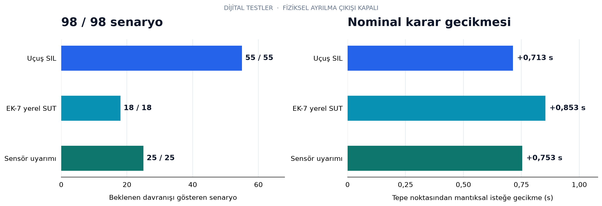
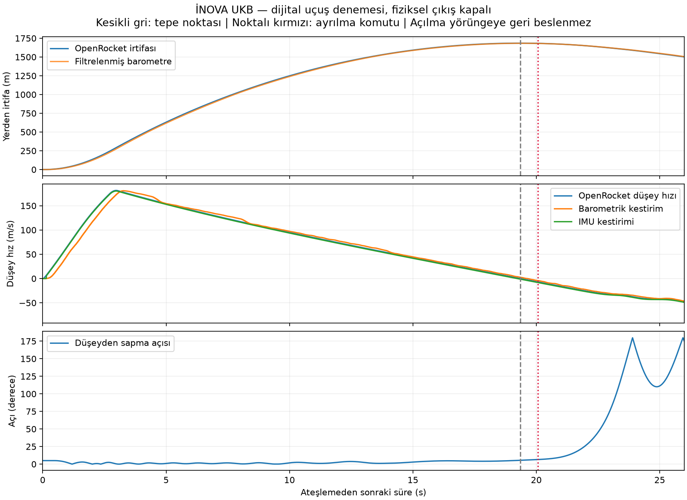
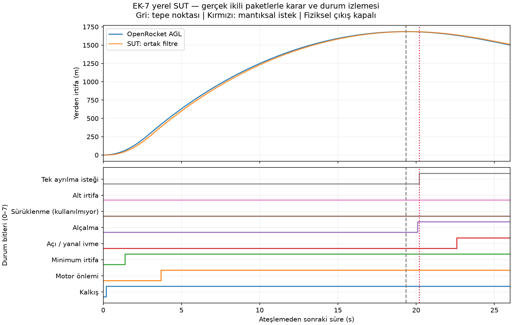
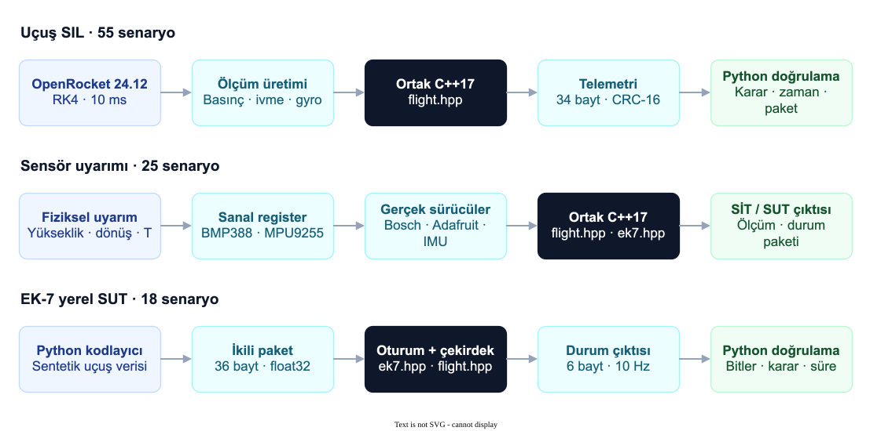

# İNOVA UKB

## Simülasyon sonuçları

| Test kümesi | Sonuç | Kayıt |
|---|---:|---|
| Uçuş SIL | 55 / 55 | [Senaryolar](avionics/results/SONUCLAR.md) · [JSON](avionics/results/summary.json) |
| EK-7 yerel SUT | 18 / 18 | [Senaryolar](avionics/results/ek7/SONUCLAR.md) · [JSON](avionics/results/ek7/summary.json) |
| Sensör uyarımı: 15 SİT + 7 uçuş + 3 SUT | 25 / 25 | [Senaryolar](avionics/results/sensors/SONUCLAR.md) · [JSON](avionics/results/sensors/summary.json) |
| EK-7 protokol / oturum | 23 test grubu | [Test kaydı](avionics/results/ek7/invariants.log) |
| Sensör sürücüleri | 12 test grubu | [Test kaydı](avionics/results/sensors/invariants.log) |
| Bağımsız Python codec | 7 test | [Test kaydı](avionics/results/test-suite.log) |
| ASan + UBSan | Geçti | [Çekirdek / EK-7](avionics/results/ek7/sanitizers.log) · [Sensörler; leak kontrolü kapalı](avionics/results/sensors/sanitizers.log) |

### OpenRocket → uçuş çekirdeği

### Sanal sensör → gerçek sürücü → SİT / SUT

### EK-7 yerel SUT → durum bitleri

## Test altyapısı

| Parametre | Değer |
|---|---|
| Kaynak uçuş modeli | [roket5500ft.ork](avionics/data/roket5500ft.ork) |
| Fizik motoru | OpenRocket 24.12 · RK4 · Δt = 10 ms |
| Rastgelelik tohumu | `20261017` |
| Saha yüksekliği | 970 m MSL |
| Bağımsız koşu tepe yüksekliği | 1684,548 m AGL |
| Tepe zamanı | Ateşlemeden 19,347 s sonra |
| Uçuş SIL nominal istek gecikmesi | Tepeden +0,713 s |
| Sensör sürücülü nominal istek gecikmesi | Tepeden +0,753 s |
| EK-7 SUT nominal istek gecikmesi | Tepeden +0,853 s · 10 Hz giriş |
| Monte Carlo | 30 koşu · varsayımsal gürültü / ölçek / gecikme dağılımları |
| Kurtarma modeli | Açık çevrim · paraşüt açılması yörüngeye geri beslenmez |

## Donanım hedefi

| Bileşen | Yapılandırma | Arayüz |
|---|---|---|
| İşlemci | ESP32-WROOM-32 · `esp32dev` geliştirme hedefi | Arduino / FreeRTOS |
| Barometre | BMP388 · 50 Hz · basınç 2× / sıcaklık 1× | I²C1 · SDA32 / SCL33 |
| IMU | MPU9255 · 100 Hz · ±16 g / ±2000 °/s | I²C0 · SDA21 / SCL22 |
| GNSS | NEO-M8N · NMEA · 9600 baud | UART2 · RX16 / TX17 |
| Radyo | SX1278 · 433 MHz · SF7 / BW125 kHz / CR4/5 · 10 dBm | SPI · SCK18 / MISO19 / MOSI23 · CS13 / RST14 / DIO26 |
| EK-7 | 115200 baud · 8N1 · MAX3232E / dişi DB9 bağlantı hedefi | UART1 · RX35 / TX4 |
| Arm girişi | Aktif LOW · pull-up | GPIO27 |
| Mantıksal istek göstergesi | Geliştirme LED’i | GPIO2 |
| Fiziksel ayrılma çıkışı | Devre dışı · sürekli LOW | GPIO25 |
| Ana UKB | Sky Logic V2 · bağımsız | Simülasyon kapsamı dışında |
| Pin / devre durumu | Önerilen geliştirme pinleri · gerçek şema / PCB doğrulanmadı | [Tasarım kaydı](avionics/docs/TASARIM.md) |

## Yazılım

| Katman | Teknoloji / sürüm | Kaynak |
|---|---|---|
| Ortak uçuş çekirdeği | C++17 · masaüstü + ESP32 | [flight.hpp](avionics/core/flight.hpp) |
| EK-7 oturumu | SİT / SUT · parser · zaman aşımı · eksen dönüşümü | [ek7.hpp](avionics/core/ek7.hpp) |
| Telemetri | 34 bayt · CRC-16 · 5 Hz | [telemetry.hpp](avionics/core/telemetry.hpp) |
| ESP32 platformu | PlatformIO 6.2.0 · espressif32 6.12.0 | [platformio.ini](avionics/platformio.ini) |
| BMP388 sürücüsü | Adafruit BMP3XX 2.1.6 + Bosch · DRDY / dönüşüm yaşı kontrolü | [bmp388.hpp](avionics/firmware/bmp388.hpp) |
| I²C sürücüsü | Adafruit BusIO 1.17.4 | [Bağımlılık kilidi](avionics/third_party/LOCK.json) |
| MPU9255 sürücüsü | Kimlik kontrolü · ADC dönüşümü · tazelik / doygunluk kontrolü | [mpu9255.hpp](avionics/firmware/mpu9255.hpp) |
| GPS / LoRa | TinyGPSPlus 1.1.0 · LoRa 0.8.0 | [firmware](avionics/firmware) |
| Test araçları | Python 3.10+ · C++17 · Java 17+ | [tools](avionics/tools) |
| Grafik / seri bağlantı | matplotlib 3.11.2 · pyserial 3.5 | [requirements.txt](avionics/requirements.txt) |

## Karar parametreleri

| İşlem | Yapılandırma |
|---|---|
| Kalibrasyon | ≥2 s durgun veri · yer basıncı / yerçekimi / gyro ofseti |
| Armlanma | 250 ms sağlıklı ve durgun veri |
| Kalkış | Özgül ivme >1,8 g · 80 ms doğrulama |
| Coast | Özgül ivme <0,55 g · 150 ms doğrulama |
| Basınç filtresi | Medyan-3 · düşük geçiren τ = 50 ms · eğim penceresi 400 ms |
| IMU kestirimi | Quaternion yönelim · yerçekimi çıkarımı · düşey ivme integrasyonu |
| Ayrılma kapıları | Coast · kalkıştan ≥3,5 s · ≥50 m AGL · tepeden ≥1,5 m düşüş |
| Düşüş doğrulaması | Barometrik hız <−0,8 m/s · IMU hızı <−0,5 m/s · 100 ms |
| Sensör tazeliği | Fiziksel giriş profilinde IMU 40 ms · barometre 120 ms |
| ÖTR algoritma farkı | 150° zorunlu açı koşulu yerine IMU düşey hız doğrulaması |
| Parametre durumu | Geliştirme seçimleri · fiziksel uçuş kabulü yapılmadı |

## EK-7 yerel profil

| Parametre | Değer |
|---|---|
| Ölçüm / durum paketi | 36 / 6 bayt |
| SİT / durum çıkışı | 10 Hz |
| Varsayılan SUT girişi | 10 Hz · ayrıca 20 / 50 / 100 Hz testleri |
| Başlatma / çerçeve / SUT zaman aşımı | 1000 / 100 / 1000 ms |
| Float / checksum | Little-endian float32 · `sum(header + payload) mod 256` |
| Komut profili | Tablo 1 sabitleri |
| Yönelim / ivme | Euler RzRyRx · özgül kuvvet · EK-7 +X ↔ çekirdek +Z burun ekseni |
| A1 çıkış eşlemesi | Bit7 tek ayrılma isteği · bit5 kullanılmıyor |
| Gereksinim kaydı | [63 madde: 29 yerel yazılım / 18 karma / 5 resmî teyit / 11 donanım](avionics/docs/EK7_DURUM.md) |
| Resmî cihaz uyumluluğu | Doğrulanmadı |

## Derleme ve doğrulama kapsamı

| Ölçüt | Durum |
|---|---|
| ESP32 hedef derlemesi | `esp32_bench` · başarılı |
| RAM | 23.316 / 327.680 bayt · %7,1 |
| Flash | 338.373 / 1.310.720 bayt · %25,8 |
| Kaynak / ikili kimliği | [SHA-256 derleme kaydı](avionics/artifacts/BUILD.json) |
| Sensör modeli | BMP388 sentetik trim · MPU9255 16 bit ADC / 4 ms varsayımsal filtre |
| Sürücü yürütümü | Gerçek sürücü kodu · sanal I²C register modelleri · masaüstü |
| Fiziksel kart / sensör / RF / güç / mekanik | Test edilmedi |
| Fiziksel ayrılma | `INOVA_PHYSICAL_OUTPUT=0` |
| Arıza senaryosu kabulü | Beklenen komut engelleme · kurtarma başarısı ölçümü değil |
| Tekrar çalıştırma | [Kurulum / test / derleme](avionics/README.md) |
