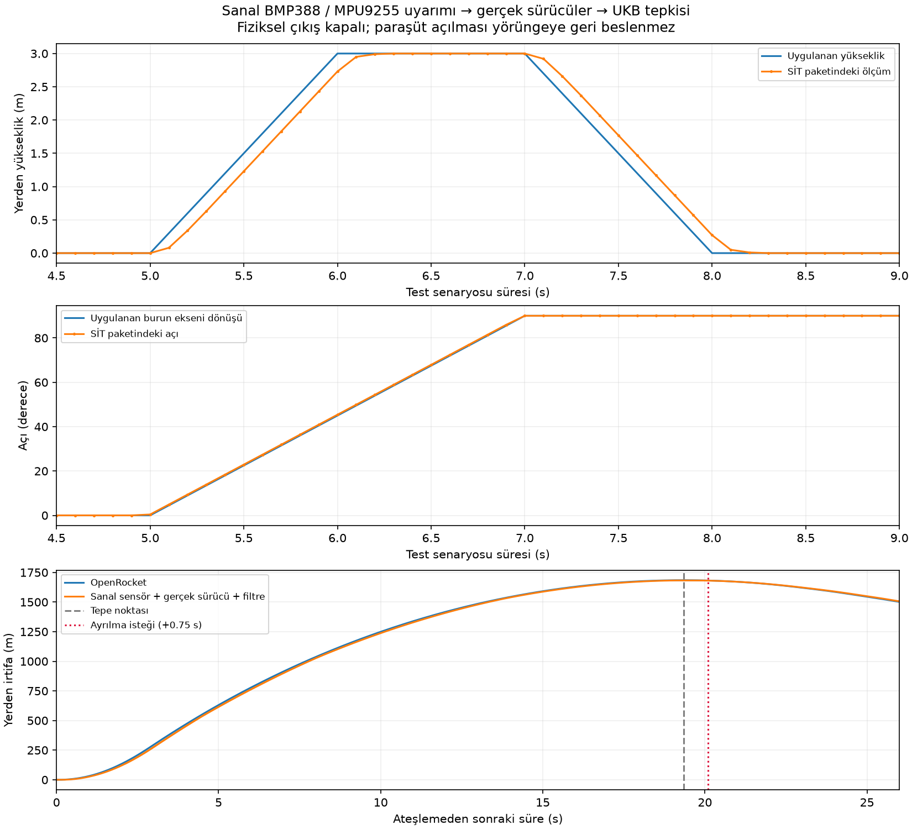

# Sensör uyarımlı SİT/SUT sonuçları

**25/25 senaryo; 12 sürücü test grubu geçti.**

Uyarım → sensör register modeli → aynı MPU9255 / Adafruit BMP3XX / Bosch / BusIO sürücüleri → uçuş çekirdeği → EK-7 ikili paketi yolu çalıştırıldı. Fiziksel kart çalıştırılmadı.

| Senaryo | Mod | Sonuç | Ölçüm |
|---|---|---|---|
| sit_pad | SİT | GEÇTİ | {"final_altitude_msl_m": 970.0} |
| sit_lift_3m | SİT | GEÇTİ | {"final_altitude_msl_m": 973.0} |
| sit_lift_return | SİT | GEÇTİ | {"final_altitude_msl_m": 970.0, "peak_altitude_msl_m": 973.0} |
| sit_rotate_x | SİT | GEÇTİ | {"orientation_error_deg": 0.0, "reported_angles_deg": [180.0, 90.0, 180.0]} |
| sit_rotate_y | SİT | GEÇTİ | {"orientation_error_deg": 0.0, "reported_angles_deg": [0.0, 0.0, 90.0]} |
| sit_rotate_z | SİT | GEÇTİ | {"orientation_error_deg": 0.0, "reported_angles_deg": [90.0, 0.0, 0.0]} |
| sit_temperature | SİT | GEÇTİ | {"final_altitude_msl_m": 970.0, "final_temperature_c": 35.0} |
| sit_pad_jolt | SİT | GEÇTİ | {"final_altitude_msl_m": 970.0} |
| sit_pressure_spike | SİT | GEÇTİ | {"final_altitude_msl_m": 970.0} |
| sit_imu_nack | SİT | GEÇTİ | {} |
| sit_imu_short | SİT | GEÇTİ | {} |
| sit_imu_stopped | SİT | GEÇTİ | {} |
| sit_bmp_nack | SİT | GEÇTİ | {} |
| sit_bmp_short | SİT | GEÇTİ | {} |
| sit_bmp_stopped | SİT | GEÇTİ | {} |
| flight_nominal | Uçuş | GEÇTİ | {"release_time_s": 25.3, "apogee_delay_s": 0.7534031980000009} |
| flight_noise | Uçuş | GEÇTİ | {"release_time_s": 25.28, "apogee_delay_s": 0.7334031980000013} |
| flight_unarmed | Uçuş | GEÇTİ | {"release_time_s": null, "apogee_delay_s": null} |
| flight_pressure_spike | Uçuş | GEÇTİ | {"release_time_s": 25.3, "apogee_delay_s": 0.7534031980000009} |
| flight_imu_stopped | Uçuş | GEÇTİ | {"release_time_s": null, "apogee_delay_s": null} |
| flight_bmp_stopped | Uçuş | GEÇTİ | {"release_time_s": null, "apogee_delay_s": null} |
| flight_saturation | Uçuş | GEÇTİ | {"release_time_s": null, "apogee_delay_s": null} |
| sut_clean | SUT | GEÇTİ | {"release_time_s": 26.41, "apogee_delay_s": 0.8534031979999988} |
| sut_disturbed | SUT | GEÇTİ | {"release_time_s": 26.41, "apogee_delay_s": 0.8534031979999988} |
| sut_stream_gap | SUT | GEÇTİ | {"release_time_s": null, "apogee_delay_s": null} |

BMP388 dönüşümü durduğunda eski değer yeni örnek diye raporlanıyordu: veri-hazır bayraklarıyla giderildi. Uzun kesinti sonrası tamamlanmış eski dönüşüm de 100 ms yaş kontrolüyle atılıyor.

BMP388 trim değerleri gerçek modülden alınmış değildir: P=131072−rawP/128 ve T=(rawT−5120000)/65536 olacak şekilde seçilmiş test fixture’ıdır. Basınç/sıcaklık bayt sırası, kalibrasyon CRC ve gerçek vendor compensation yolu test edilir; gerçek sensörün bütün transfer fonksiyonu doğrulanmış olmaz.

MPU9255 için ±16g/±2000°/s, ADC nicemlemesi, 100 Hz ve DRDY davranışı modellenir. 4 ms birinci dereceden filtre ölçülmüş sensör dağılımı değildir. Manyetometre, GNSS ve LoRa silisyumu modellenmez.

`inhibit` arızada kurtarma yapıldığı anlamına gelmez. GPIO25 kapalı; ana Sky Logic, güç, EMI, analog hatlar, gerçek zamanlayıcı ve mekanik ayrılma test edilmedi. Resmî EK-7 profil belirsizlikleri sürer.
